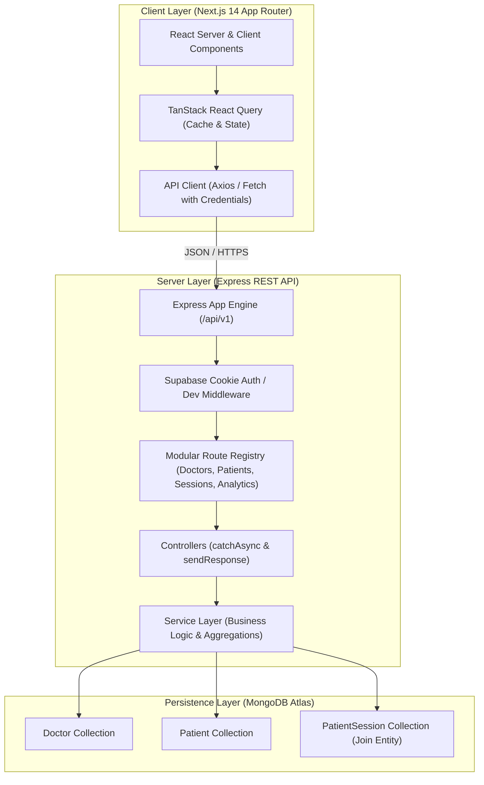

# DocTrack — Healthcare Administration & Clinical Caseload Management Platform

> A high-performance, enterprise-ready healthcare management application built with **Node.js/Express**, **MongoDB Atlas**, **Next.js 14 App Router**, and **Recharts**. Engineered for healthcare administrative staff to manage medical practitioners, track patient caseloads, schedule clinical encounters via custom pickers, and visualize operational intelligence.

---

## 1. Project Overview & Elevator Pitch

**DocTrack** addresses the critical operational challenge of clinical caseload imbalances and fragmented patient scheduling in multi-specialty healthcare networks. By unifying practitioner directories, master patient rosters, and encounter scheduling into an intuitive, real-time administrative cockpit, DocTrack empowers clinical supervisors to:
- **Prevent Practitioner Burnout**: Monitor active and scheduled caseload ratios across departments in real-time.
- **Streamline Patient Care Workflows**: Link existing patients or register new patients inline atomically without navigating away from the clinical context (Workflow 4.1).
- **Gain Operational Visibility**: Analyze 14-day encounter volume trajectories, department distributions, and provider capacity metrics through an executive analytics dashboard.

---

## 2. Key Features

- **Executive Analytics Cockpit (`/dashboard`)**:
  - 4 Dynamic KPI Cards: Total Doctors, Active Patient Population, Clinical Encounters, and Average Caseload Ratio.
  - **Recharts Bar Chart**: Top practitioners ranked by active patient caseload.
  - **Recharts Donut Chart**: Specialty distribution across the medical network.
  - **Recharts Area Chart**: 14-day dual-gradient trend showing daily completed consultations vs. upcoming scheduled appointments.
- **Medical Staff Management (`/doctors`)**:
  - Live doctor table with initials avatars, hospital affiliations, contact info, and active patient badges (`N Patients →`).
  - Search with 300ms debounce, specialty filtering, and sorting (Newest, Alphabetical, Caseload).
  - Central modal for registering new medical practitioners.
  - Caseload inspection modal with disassociate controls.
- **Master Patient Directory (`/patients`)**:
  - Patient table with initials avatar badges, attending physician indicators, condition/diagnosis badges, appointment timestamps, and status pills.
  - Multi-criteria filtering by medical condition, status, and debounced text search (Name, Phone, Email).
  - Standalone master patient registration and demographic edit modals.
- **Workflow 4.1: Dual Encounter Scheduler Modal**:
  - Accessible directly from the Doctor Directory.
  - **Tab 1 (Link Existing Patient)**: Connects registered patients to attending doctors with custom calendar `DatePicker` and 30-minute slot `TimePicker`.
  - **Tab 2 (Register New Inline)**: Atomically creates new master patient records and schedules their initial encounter in a single transaction.
- **Zero-Latency State Synchronization**:
  - Optimistic cache invalidations via TanStack Query ensure doctor caseload counters and patient directory rows update in real-time without full-page reloads.

---

## 3. System Architecture & Data Flow

DocTrack follows a decoupled client-server architecture with strict separation between presentation, business logic, and database operations.



---

## 4. Deep-Dive: Core Technical Decisions

### Decision 1: Decoupled Monorepo (Express API + Next.js 14 App Router) vs. Unified Full-Stack Framework

- **Context**: The project required complex MongoDB aggregation pipelines, high-throughput encounter mutations, and an interactive administrative client.
- **Decision**: Architected the project as two distinct workspaces (`server/` and `client/`) sharing a unified repository:
  1. **Independent Scalability**: The Express REST API can scale independently behind a load balancer or be containerized into microservices without redeploying the Next.js frontend assets.
  2. **Security & Surface Minimization**: Server-side secrets (MongoDB connection string, Supabase service roles) remain completely isolated in `server/`, eliminating the risk of accidental client bundle leakage.
  3. **Separation of Concerns**: The backend follows a strict **Controller-Service** pattern, while the frontend focuses exclusively on presentation, optimistic cache management, and UI reactivity.

### Decision 2: 3-Entity Relational Data Model (`Doctor` ↔ `PatientSession` ↔ `Patient`) vs. Embedded Subdocuments

- **Context**: Doctors have multiple patients, and patients can attend multiple clinical sessions across different specialties over time.
- **Decision**: Implemented `PatientSession` as an independent join entity rather than embedding patient sessions directly inside `Doctor` or `Patient` documents:
  1. **Prevention of 16MB BSON Document Limit**: In high-volume clinics, embedding sessions directly inside doctor documents causes unbounded document growth and eventual write failures.
  2. **Bi-Directional Query Optimization**: Storing encounters as first-class documents enables independent compound indexing:
     - `{ doctorId: 1, status: 1 }` for instant caseload calculations.
     - `{ patientId: 1, doctorId: 1 }` for patient history lookups.
     - `{ sessionDate: -1, status: 1 }` for 14-day temporal analytics.
  3. **Referential Integrity & Safe Cascading**: If an encounter is completed, cancelled, or disassociated, neither the doctor profile nor the master patient record is mutated or duplicated.

---

## 5. Security Architecture & Threat Mitigation

| Threat Vector | Mitigation Strategy | Implementation Details |
| :--- | :--- | :--- |
| **Cross-Site Scripting (Stored & Reflected XSS)** | React DOM text node encoding + HTML entity sanitization | Injected `<script>` or `` strings in patient names, emails, and conditions are encoded to text nodes. |
| **NoSQL / Regex Injection & ReDoS** | Regex metacharacter neutralization | All user query parameters pass through `escapeRegex()` before entering MongoDB `$regex` filters, preventing ReDoS and syntax crashes. |
| **Input Boundary Violations** | Client & HTML5 constraint validation | Age inputs enforce `min="1"` and `max="125"`, preventing negative and overflow numbers before hitting the database. |
| **Sensitive Data Exposure** | Strict DTO projections & Mongoose transform | MongoDB `__v` and internal fields are stripped via `toJSON: { versionKey: false }` and aggregate `$project` stages. |
| **Referential Integrity Loss** | Cascade deletion hooks | Deleting a patient triggers `PatientSession.deleteMany({ patientId })`, eliminating orphaned sessions and preventing dangling pointers. |

---

## 6. Installation & Setup Guide

### 6.1 Prerequisites
- **Node.js**: v18.0+ or v20.0+
- **MongoDB Atlas**: An active MongoDB connection string
- **Operating System**: Windows / macOS / Linux

### 6.2 Backend Setup (`server/`)
```bash
# Navigate to server directory
cd server

# Install dependencies
npm install

# Configure environment variables
# Create server/.env with:
PORT=5000
MONGODB_URI=your_mongodb_atlas_connection_string
DEV_MODE=true
CLIENT_URL=http://localhost:3000

# Build and seed database
npm run build
npm run seed

# Start Express server
npm start
```
*Health Check*: Verify `http://localhost:5000/api/health` returns status `"healthy"`.

### 6.3 Frontend Setup (`client/`)
```bash
# Navigate to client directory
cd client

# Install dependencies
npm install

# Configure environment variables
# Create client/.env.local with:
NEXT_PUBLIC_API_URL=http://localhost:5000/api/v1

# Build and start Next.js client
npm run build
npm start
```
*Access UI*: Open `http://localhost:3000` in your browser.

---

## 7. Automated Test Suite Execution

### Running Backend API Automated Tests (8 Test Cases)
```bash
cd server
npm run test:cases
```
*Expected Output*:
```
[PASS] TC-1: Health check endpoint returns status healthy
[PASS] TC-2: GET /api/v1/doctors returns paginated list with caseloads
[PASS] TC-3: POST /api/v1/doctors creates a new doctor record
[PASS] TC-4: GET /api/v1/patients returns master patient directory
[PASS] TC-5: POST /api/v1/patients creates a new master patient
[PASS] TC-6: POST /api/v1/doctors/:id/sessions links encounter (Workflow 4.1)
[PASS] TC-7: DELETE /api/v1/doctors/:id/sessions/:sessionId disassociates encounter
[PASS] TC-8: DELETE /api/v1/doctors/:id deletes doctor record cleanly
ALL 8/8 BACKEND TEST CASES PASSED SUCCESSFULLY.
```

---

## 8. Verified Visual Evidence

- **[Executive Analytics Dashboard](doctrack_goal4_analytics_dashboard.png)**: KPI cards, caseload bar chart, specialty donut, and 14-day encounter area chart.
- **[Doctor Directory](doctrack_goal2_ui.png)**: Doctor profiles, contact info, active caseload buttons, and 3-dot action menus.
- **[Caseload Inspection Modal](doctrack_goal3_assigned_patient_inspected.png)**: Active clinical encounters under attending physicians.
- **[Workflow 4.1 Encounter Scheduler](doctrack_goal3_assign_patient_modal.png)**: Dual-tab modal with custom month `DatePicker` and slot `TimePicker`.
- **[Master Patient Directory](doctrack_goal3_patients_directory_synchronized.png)**: Cross-synchronized patient roster displaying assigned doctors and conditions.
- **[Tablet Viewport (1024px)](doctrack_goal4_tablet_1024.png)**: Responsive layout and chart reflow on tablet screens.
- **[Mobile Viewport (390px)](doctrack_goal4_mobile_390.png)**: Compact layout with off-canvas sidebar navigation.

---

## 9. Technology Stack

- **Frontend**: Next.js 14 (App Router), React 18, Tailwind CSS, TanStack React Query, Zustand, Recharts, Lucide React.
- **Backend**: Node.js, Express.js, TypeScript, Mongoose ODM.
- **Database**: MongoDB Atlas (Cloud Cluster).
- **Design Tokens**: Purples (`#6559cc`), Teals (`#2c9a8b`), Dark Navy (`#202138`), Slate Grays (`#64748b`).
- **Testing & Verification**: Playwright MCP Browser Suite, Node Test Runner.
