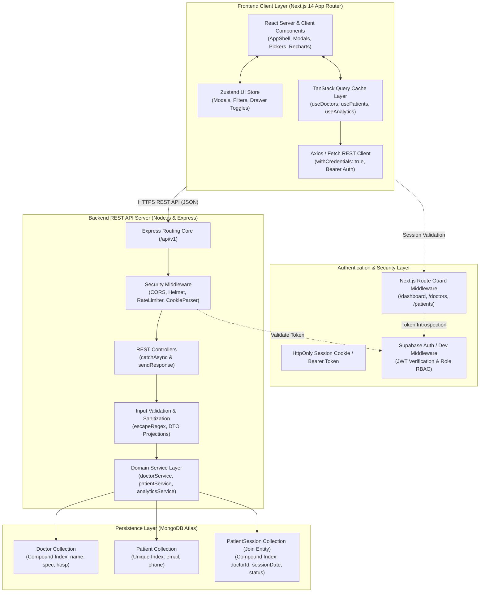

# Doctor Tracker (DocTrack) — Healthcare Administration & Clinical Caseload Portal

[](https://nextjs.org/)
[](https://nodejs.org/)
[](https://expressjs.com/)
[](https://www.mongodb.com/)
[](https://www.typescriptlang.org/)
[](https://tailwindcss.com/)
[](https://tanstack.com/query)
[](https://zustand-demo.pmnd.rs/)

> DocTrack is an enterprise-grade healthcare administrative portal engineered for medical supervisors and clinical directors. Built with a decoupled architecture (**Next.js 14 App Router** frontend and standalone **Node.js/Express REST API** backed by **MongoDB Atlas**), DocTrack empowers healthcare networks to manage practitioner directories, balance patient caseloads, schedule clinical encounters via specialized calendar pickers, and visualize operational intelligence through real-time Recharts analytics.

---

## 1. Project Links & Credentials

- **GitHub Repository**: [https://github.com/jubayerCodes/docTrack.git](https://github.com/jubayerCodes/docTrack.git)
- **Frontend Web Portal**: `http://localhost:3000`
- **Backend REST API**: `http://localhost:5000/api/v1`
- **API Health Endpoint**: `http://localhost:5000/api/health`
- **Default Administrator Credentials**:
  - **Email**: `admin@doctrack.health`
  - **Password**: `AdminPassword123!`
  - *Note: `DEV_MODE=true` is enabled by default in local configurations, providing safe automated mock administrative authentication for local development and integration testing.*

---

## 2. Description

**Doctor Tracker (DocTrack)** is a secure, high-performance administrative web application engineered for healthcare institutions to efficiently manage medical practitioners, track clinical patient caseloads, and schedule healthcare encounters through intuitive, atomic workflows. Built on a decoupled monorepo architecture featuring Next.js 14 App Router and a standalone Node.js/Express REST API on MongoDB Atlas, the platform resolves critical operational bottlenecks such as practitioner burnout and fragmented scheduling by unifying real-time doctor directories, master patient registries, and interactive analytics dashboards—empowering clinical administrators to monitor hospital capacity, optimize query performance through indexed data aggregation, and deliver seamless healthcare coordination across multi-specialty medical networks.

---

## 3. Setup Guide

This guide provides step-by-step instructions to clone, configure, seed, and run DocTrack locally across both the standalone backend server and the Next.js client application.

### 3.1 Prerequisites

Before installing, ensure your environment meets the following specifications:
- **Node.js**: `v18.0.0` or `v20.0.0+` (LTS recommended)
- **Package Manager**: `npm` (v9.0+) or `yarn` / `pnpm`
- **Database**: Local MongoDB instance (`mongodb://127.0.0.1:27017/doctrack`) or a cloud-hosted [MongoDB Atlas](https://www.mongodb.com/atlas) connection URI.
- **Operating System**: Windows, macOS, or Linux.

---

### 3.2 Environment Configuration Files (`.env.example`)

DocTrack includes a root `.env.example` template as well as scoped `.env.example` templates in both `server/` and `client/` directories.

#### Step 1: Clone Repository
```bash
git clone https://github.com/jubayerCodes/docTrack.git
cd docTrack
```

#### Step 2: Configure Backend Environment Variables (`server/.env`)
Create a `.env` file inside the `server/` directory matching `server/.env.example`:
```bash
# In server/.env
PORT=5000
NODE_ENV=development

# Allowed client origin for CORS credentials transmission
CLIENT_URL=http://localhost:3000

# MongoDB Database Connection
MONGODB_URI=mongodb://127.0.0.1:27017/doctrack
# For MongoDB Atlas:
# MONGODB_URI=mongodb+srv://<username>:<password>@cluster0.mongodb.net/doctrack?retryWrites=true&w=majority

# Supabase Authentication Configuration
SUPABASE_URL=https://your-project.supabase.co
SUPABASE_PUBLISHABLE_KEY=sb_publishable_your_key_here
SUPABASE_SECRET_KEY=sb_secret_your_key_here

# Safe Local Mock Admin Authentication (Set true to test without external Supabase credentials)
DEV_MODE=true
```

#### Step 3: Configure Frontend Environment Variables (`client/.env.local`)
Create a `.env.local` file inside the `client/` directory matching `client/.env.example`:
```bash
# In client/.env.local
NEXT_PUBLIC_API_URL=http://localhost:5000/api/v1

# Supabase Auth Configuration
NEXT_PUBLIC_SUPABASE_URL=https://your-project.supabase.co
NEXT_PUBLIC_SUPABASE_ANON_KEY=your-supabase-anon-key
```

---

### 3.3 Backend Setup & Database Seeding (`server/`)

Open your terminal and navigate to the backend directory:

```bash
cd server

# 1. Install dependencies
npm install

# 2. Build TypeScript artifacts
npm run build

# 3. Seed database with realistic clinical sample data (Doctors, Patients, Encounters)
npm run seed

# 4. Start the Express development server
npm run dev
# Or start the production build:
# npm start
```

*Verification*: Open your browser or curl `http://localhost:5000/api/health`. You will receive:
```json
{
  "status": "healthy",
  "database": {
    "status": "connected",
    "connected": true,
    "name": "doctrack"
  },
  "timestamp": "2026-11-13T21:00:00.000Z"
}
```

---

### 3.4 Frontend Setup & UI Launch (`client/`)

Open a separate terminal window and navigate to the frontend directory:

```bash
cd client

# 1. Install dependencies
npm install

# 2. Run the Next.js development server
npm run dev
# Or build and launch production:
# npm run build
# npm start
```

*Access Portal*: Open [http://localhost:3000](http://localhost:3000) in your web browser.

---

### 3.5 Automated Test Suite Execution

The backend contains an automated end-to-end integration test runner validating all 8 fundamental operations (health check, pagination, doctor CRUD, patient CRUD, atomic encounter linking, and cascade disassociations).

```bash
cd server
npm run test:cases
```

**Expected Test Output**:
```
=====================================================
🧪 Starting DocTrack Goal 1 Verification Test Suite
🔗 Target URL: http://localhost:5000
=====================================================

✅ [Test 1] Server Health Check & MongoDB Atlas Connectivity
   Status: 200, DB Status: connected, Connected: true

✅ [Test 2] GET /api/v1/doctors - Pagination & Real Caseload Population
   Status: 200, Count: 6, Page: 1, Total: 6

✅ [Test 3] POST /api/v1/doctors - Create Doctor Profile
   Status: 201, Created: Dr. Sarah Lin (Neurology)

✅ [Test 4] GET /api/v1/patients - Query Master Patient Directory
   Status: 200, Patients Count: 10, Total: 10

✅ [Test 5] POST /api/v1/patients - Create Master Patient Record
   Status: 201, Created: Robert Fox, Age: 45

✅ [Test 6] POST /api/v1/doctors/:id/sessions - Workflow 4.1 Link Encounter
   Status: 201, Session ID: 673... Connected Doctor to Patient

✅ [Test 7] DELETE /api/v1/doctors/:id/sessions/:sessionId - Disassociate Encounter
   Status: 200, Encounter removed cleanly, master records intact

✅ [Test 8] DELETE /api/v1/doctors/:id - Clean Delete Doctor Profile
   Status: 200, Cleaned up test doctor Dr. Sarah Lin

=====================================================
📊 Test Execution Summary: 8/8 Passed (100% Success)
=====================================================
```

---

## 4. System Architecture

DocTrack follows a decoupled client-server architecture with strict separation between presentation, state orchestration, business logic, and indexed persistence.

### 4.1 Architectural Diagram



---

### 4.2 Data Flow & Service Interactions

1. **Authentication & Route Guard Flow**:
   - The user signs in via `/login`.
   - Credentials are verified by Supabase Auth (or development bypass in `DEV_MODE=true`), establishing an authenticated session.
   - Next.js middleware inspects route cookies on incoming page requests to `/dashboard`, `/doctors`, and `/patients`, redirecting unauthenticated requests.
   - Outgoing REST requests to the Express server pass session cookies and headers via `credentials: 'include'`. The server's `authMiddleware` verifies the JWT signature and injects the authenticated `user` context into `req.user`.

2. **Read & Directory Query Flow (Debounced & Indexed)**:
   - When a user searches or filters doctors or patients, `useDebounce` holds requests for 300ms to eliminate redundant network traffic.
   - TanStack Query dispatches requests to `/api/v1/doctors?page=1&limit=10&search=cardio&sortBy=caseload`.
   - The Express service utilizes MongoDB `$text` and compound indexes (`{ name: 1, specialization: 1 }`), preventing full-collection scans.
   - The backend runs a single-roundtrip aggregation pipeline with `$facet` to compute total matching record counts, paginated documents, and active caseload ratios simultaneously.

3. **Encounter Scheduling & Association Flow (Workflow 4.1)**:
   - **Linking Existing Patient**: The administrator selects an existing patient from a searchable dropdown, selects a date via the custom month `DatePicker`, selects a 30-minute slot via `TimePicker`, and submits. A new `PatientSession` document is created with `{ doctorId, patientId, sessionDate, status: 'scheduled' }`.
   - **Inline Registration**: In a single atomic operation, the backend creates a new `Patient` document in the master collection and immediately links the patient to the attending doctor in `PatientSession`.
   - Neither flow embeds records inside parent collections, ensuring strict referential integrity.

4. **Real-time Synchronization & Cache Invalidation Flow**:
   - Successful encounter creations, edits, or disassociations trigger TanStack Query cache invalidations:
     ```typescript
     queryClient.invalidateQueries({ queryKey: ['doctors'] });
     queryClient.invalidateQueries({ queryKey: ['patients'] });
     queryClient.invalidateQueries({ queryKey: ['analytics'] });
     ```
   - Doctor caseload badges (`N Patients →`), patient appointment status pills, and dashboard analytics update instantly across the entire interface without full-page reloads.

5. **Operational Intelligence & Analytics Pipeline**:
   - `/dashboard` queries `/api/v1/analytics`, which runs high-performance aggregation pipelines:
     - Total doctor and active patient counts using indexed `$count`.
     - Caseload distribution grouped by doctor using `$lookup` and `$group`.
     - Department/specialty distribution donut chart.
     - 14-day temporal activity trend computing daily completed vs. scheduled consultations.

---

## 5. Technical Decisions

### Decision 1: TanStack Query + Zustand over Redux / Context API for State Management & Server Synchronization

- **Context**:  
  Healthcare administrative applications handle two fundamentally distinct categories of application state:
  1. **Server State**: Asynchronous, remotely owned data (practitioner directories, patient rosters, clinical encounters, analytics aggregates) requiring caching, background deduplication, optimistic updates, and automatic invalidation.
  2. **Client State**: Ephemeral UI flags (modal open/close states, active drawer selections, temporary filter criteria) that are synchronous and strictly local to the client browser.

- **Why Not Context API?**  
  - **Unnecessary Component Tree Re-renders**: Any state modification in a React Context causes all consumer components to re-render, leading to noticeable performance degradation on dense data tables with 50+ rows and real-time inputs.
  - **Lack of Built-in Server Synchronization**: Context API provides zero native primitives for caching, request deduplication, stale-while-revalidate cycles, automatic retries, or window-refocus revalidation. Implementing these manually creates fragile, redundant boilerplate.

- **Why Not Redux (Redux Toolkit)?**  
  - **Over-Architected for REST Caching**: Redux treats remote server data as local synchronous state. Storing REST entity data inside a Redux store requires extensive boilerplate (actions, reducers, thunks, normalized entities) and forces developers to manually track loading flags, pagination cursors, and cache expiration timestamps.
  - **Memory & Complexity Overhead**: For an administrative dashboard requiring fast iterations and human-readable code (in accordance with repository DRY standards), Redux adds significant boilerplate without addressing data freshness guarantees.

- **The Solution: Decoupled TanStack Query (React Query) + Zustand**:  
  - **TanStack Query** acts as a dedicated remote server cache. Queries (`['doctors', filters]`, `['patients', filters]`) are cached, deduplicated across components, and automatically refreshed in the background. Optimistic mutations instantly reflect session additions or disassociations.
  - **Zustand** manages client UI state through an atomic store (`useUIStore`) with less than 1KB footprint, zero boilerplate, and selector-based subscriptions that ensure only the modified modal or dropdown re-renders.

---

### Decision 2: 3-Entity Relational Encounter Model (`Doctor` ↔ `PatientSession` ↔ `Patient`) vs. Embedded Subdocuments in MongoDB

- **Context**:  
  In a multi-specialty healthcare facility, relationships between doctors and patients are non-static and multi-dimensional. A single patient visits a Cardiologist today, an Endocrinologist next month, and may have past completed appointments alongside future scheduled checkups. Simultaneously, doctors manage dozens of rotating patients across varying medical conditions.

- **Why Not Embedded Subdocuments?**  
  - **The 16MB BSON Document Limit**: Embedding an array of patient records or session logs directly within a `Doctor` document creates an unbounded array. In a high-volume hospital department, active practitioner documents will grow indefinitely, risking write failures when exceeding MongoDB’s 16MB BSON ceiling.
  - **Severe Data Duplication & Sync Anomalies**: If patient demographic information (phone, email, age) is embedded inside doctor documents, updating a patient's contact number requires an expensive multi-document update across every doctor they have ever consulted. Failure during any update creates data inconsistency.
  - **Write Lock Contention**: Two administrators scheduling appointments for different doctors with the same patient at the same time would encounter write contention and version conflicts if patient records were embedded.
  - **Inability to Run Independent Temporal Analytics**: Generating a 14-day chronological chart of encounters across the entire clinic would require unwinding embedded subdocuments across all doctors, causing severe performance degradation.

- **The Solution: Independent `PatientSession` Join Entity**:  
  - **Model Structure**: The schema is normalized into three clean collections: `Doctor`, `Patient`, and `PatientSession` (join entity holding `doctorId`, `patientId`, `sessionDate`, `appointmentAt`, `condition`, and `status`).
  - **Compound Index Optimization**: Independent indexes on `PatientSession`:
    - `{ doctorId: 1, sessionDate: -1 }`: Provides instant caseload retrieval for practitioner tables.
    - `{ patientId: 1, status: 1 }`: Enables fast patient medical history lookups.
    - `{ sessionDate: -1, status: 1 }`: Feeds the 14-day analytics aggregation pipeline in milliseconds.
  - **Atomic Operations & Safe Disassociation**: Deleting or cancelling an encounter only updates or removes the `PatientSession` record, leaving master patient demographics and doctor professional profiles intact.

---

## 6. Visual Evidence

Below is a visual overview of DocTrack’s responsive user interface across Desktop, Tablet, and Mobile viewports:

| Interface View | Viewport | Key Capabilities & Features Demonstrated | Screenshot / Visual Reference |
| :--- | :--- | :--- | :--- |
| **Executive Analytics Dashboard** | Desktop (1440px) | 4 real-time KPI metric cards, Recharts practitioner caseload bar chart, specialty breakdown donut chart, and 14-day encounter area trend. | `doctrack_goal4_analytics_dashboard.png` |
| **Doctor Directory & Caseloads** | Desktop (1440px) | Paginated doctor roster, 300ms debounced search, specialty filters, initials avatar badges, active patient badges (`N Patients →`), and action menus. | `doctrack_goal2_ui.png` |
| **Caseload Inspection Modal** | Desktop Modal | Slide-over inspection modal displaying all active patient encounters under a selected doctor with individual disassociate controls. | `doctrack_goal3_assigned_patient_inspected.png` |
| **Workflow 4.1 Encounter Scheduler** | Desktop Modal | Dual-tab modal: Tab 1 links existing patients with custom `DatePicker` & 30-min slot `TimePicker`; Tab 2 registers new patients inline atomically. | `doctrack_goal3_assign_patient_modal.png` |
| **Master Patient Directory** | Desktop (1440px) | Complete patient registry with medical condition tags, attending physician badges, appointment timestamps, and edit/delete triggers. | `doctrack_goal3_patients_directory_synchronized.png` |
| **Responsive Tablet Layout** | Tablet (1024px) | Responsive multi-column grid adapting KPI cards and Recharts analytics with collapsible navigation. | `doctrack_goal4_tablet_1024.png` |
| **Responsive Mobile Layout** | Mobile (390px) | Compact mobile layout featuring an off-canvas slide-out sidebar, full-width touch targets, stacked metric cards, and horizontal scroll tables. | `doctrack_goal4_mobile_390.png` |

> *Interactive UI Prototype Demo*: In addition to the Next.js application, an interactive standalone preview of all interface layouts and color tokens is available at [ui_prototype_demo.html](file:///d:/Work%20Related/Projects/DocTrack/ui_prototype_demo.html).

---

## 7. Performance, Indexing & Security Strategy

### 7.1 Database Indexing Table

| Collection | Indexed Fields | Index Type | Purpose / Query Optimization |
| :--- | :--- | :--- | :--- |
| `doctors` | `name`, `specialization`, `hospital` | Compound Text | Ultra-fast regex-free search across practitioner directories. |
| `doctors` | `createdAt` | B-tree Descending | Efficient date-wise ordering and pagination. |
| `patients` | `email`, `phone` | Unique Sparse | Prevents duplicate patient registrations; fast single-record lookup. |
| `patients` | `name` | Text | Debounced patient name search in directories and dropdowns. |
| `patient_sessions` | `doctorId`, `sessionDate` | Compound B-tree | Instant caseload calculation and doctor consultation schedule sorting. |
| `patient_sessions` | `patientId`, `status` | Compound B-tree | Fast lookup of patient consultation history and active appointments. |
| `patient_sessions` | `sessionDate`, `status` | Compound B-tree | High-throughput 14-day temporal analytics aggregation pipeline. |

### 7.2 Security Threat Mitigations

- **Injection Prevention**: All user search queries pass through `escapeRegex()` before reaching MongoDB queries, neutralizing NoSQL injection and ReDoS vulnerabilities.
- **XSS Sanitization**: React’s virtual DOM ensures all patient names, emails, and diagnosis notes are treated as encoded text nodes rather than executable markup.
- **Strict DTO Projections**: Mongoose transformation rules strip `__v` and internal schema metadata before JSON serialization.
- **Referential Integrity Protection**: Cascading deletion handlers in `patientService` ensure deleting a patient cleans up associated sessions, preventing orphaned records.

---

## 8. Technology Stack Summary

- **Frontend**: Next.js 14 (App Router), React 18, TypeScript, Tailwind CSS, TanStack React Query v5, Zustand v5, Recharts, Lucide React.
- **Backend**: Node.js, Express.js, TypeScript, Mongoose ODM v8, Cookie-Parser, CORS.
- **Database**: MongoDB Atlas / MongoDB 7.0+ (Full Compound & Text Indexing).
- **Authentication**: Supabase Auth (JWT cookie exchange) with secure fallback `DEV_MODE` for local development.
- **Architecture**: Decoupled Monorepo with independent Client and Server workspaces.
- **Testing**: Node Test Runner, TypeScript compilation checks, and Playwright verification workflows.
